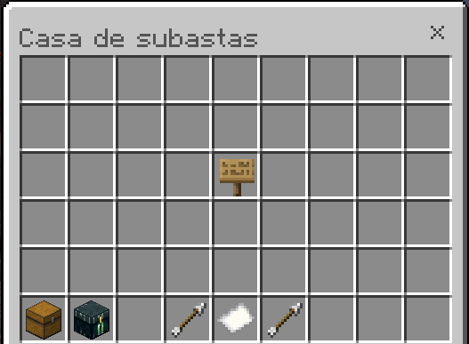
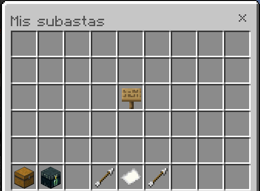
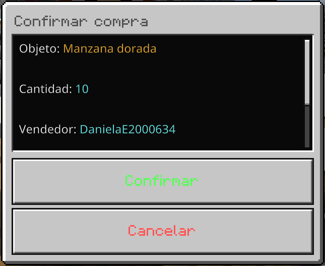
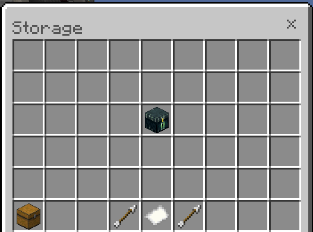
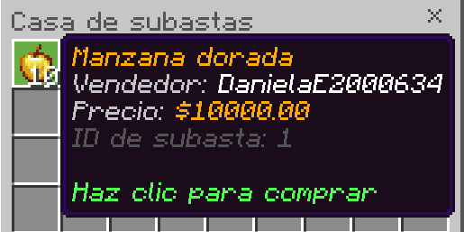

# 🔨 AuctionHouseNK

<p align="center">
  
  
  
  
</p>

<p align="center">
  **Una casa de subastas completa, configurable y persistente para servidores Minecraft Bedrock.**
</p>

---

## 📖 ¿Qué es AuctionHouseNK?

**AuctionHouseNK** es un plugin de casa de subastas desarrollado para servidores Minecraft Bedrock que utilizan **NukkitPetteriM1Edition (PM1E)**.

Permite a los jugadores publicar objetos a la venta, consultar las ofertas disponibles, comprar artículos de otros jugadores y recuperar sus objetos cuando una publicación vence.

El objetivo es ofrecer un sistema de comercio entre jugadores con interfaces gráficas, protección durante las transacciones, límites de publicaciones por rango y almacenamiento persistente mediante SQLite.

## ✨ Características principales

- 🔨 **Casa de subastas:** permite publicar objetos y consultar las ofertas disponibles.
- 🛒 **Sistema de compras:** los jugadores pueden comprar artículos utilizando EconomyAPI.
- 🖥️ **Interfaz gráfica:** navegación mediante inventarios personalizados con FakeInventories.
- 📄 **Paginación:** permite explorar las publicaciones disponibles.
- 👤 **Publicaciones propias:** consulta las ofertas publicadas por el jugador.
- 💰 **Economía integrada:** utiliza EconomyAPI para gestionar las transacciones.
- 🔒 **Protección de compras:** evita que una misma publicación sea procesada simultáneamente por varios compradores.
- 🎒 **Comprobación de inventario:** valida el espacio disponible antes de entregar un objeto.
- ⏳ **Vencimiento automático:** las publicaciones tienen una duración configurable.
- 📦 **Storage:** conserva los objetos de publicaciones vencidas para que sus propietarios puedan recuperarlos.
- 🔐 **Límites por rango:** configura distintas cantidades de publicaciones mediante permisos.
- ♾️ **Publicaciones ilimitadas:** permite configurar límites ilimitados para determinados rangos.
- 💾 **Base de datos SQLite:** conserva las publicaciones y sus datos después de reiniciar el servidor.
- 🧩 **Serialización de objetos:** conserva los datos de los artículos almacenados.
- 📝 **Mensajes editables:** permite personalizar los mensajes del chat y los textos de las interfaces sin modificar el código fuente.

## 📋 Comandos

| Comando | Descripción |
|---|---|
| `/ah` | Abre la casa de subastas. |
| `/ah sell <precio>` | Publica el objeto que el jugador tiene en la mano. |

Los comandos y sus permisos están definidos en `plugin.yml`.

## 🖥️ Interfaz de la casa de subastas

AuctionHouseNK utiliza **FakeInventories** para ofrecer una experiencia de navegación mediante inventarios personalizados.

Desde la interfaz los jugadores pueden consultar las publicaciones disponibles, navegar entre páginas y acceder a sus propias ofertas.

<p align="center">
  
</p>

### 👤 Mis subastas

Los jugadores pueden consultar sus propias publicaciones y revisar los artículos que tienen actualmente a la venta.

<p align="center">
  
</p>

## 🛒 Sistema de compras

El proceso de compra utiliza formularios de confirmación mediante **FormConstructor**.

Antes de completar una compra, el jugador puede revisar la confirmación de la operación.

<p align="center">
  
</p>

El proceso de compra incorpora medidas para proteger las transacciones:

- Comprueba que la publicación siga disponible.
- Verifica que el comprador tenga saldo suficiente.
- Comprueba que exista espacio en el inventario.
- Evita que una misma publicación sea procesada simultáneamente por varios compradores.
- Entrega el objeto al comprador cuando la transacción se completa.

## 📦 Storage

Cuando una publicación alcanza su fecha de vencimiento, sus objetos se procesan para que el propietario pueda recuperarlos mediante el sistema Storage.

Esto permite conservar los artículos que ya no están disponibles en la casa de subastas.

<p align="center">
  
</p>

## 🧩 Conservación de datos de los objetos

AuctionHouseNK incorpora un sistema de serialización para conservar los datos de los objetos almacenados.

<p align="center">
  
</p>

## 🔐 Sistema de límites por rango

AuctionHouseNK permite establecer diferentes límites de publicaciones activas según los permisos del jugador.

Ejemplo de configuración:

| Grupo | Permiso | Límite |
|---|---|---:|
| Jugador predeterminado | Sin permiso adicional | 5 publicaciones |
| VIP | `auctionhouse.limit.vip` | 10 publicaciones |
| Administrador | `auctionhouse.admin` | Ilimitado |

Los rangos son configurables. Puedes añadir VIP+, MVP, Elite u otros grupos según la estructura de tu servidor.

### ⭐ Herencia de rangos

Si un jugador tiene varios permisos de rango, el plugin utiliza el límite numérico más alto.

Por ejemplo:

- Jugador con permiso VIP: 10 publicaciones.
- Jugador con permisos VIP y VIP+: se aplica el límite más alto.
- Jugador con `auctionhouse.admin`: publicaciones ilimitadas.

**Importante:** un límite de `0` representa publicaciones ilimitadas.

## ⚙️ Configuración

El archivo principal de configuración es `config.yml`.

```yaml
auction:
  # Duración de una publicación en horas.
  listing-duration-hours: 24

  # Límites máximos de publicaciones por rango.
  # 0 significa publicaciones ilimitadas.
  listing-limits:
    default: 5
    vip: 10

  # Impuesto porcentual sobre las ventas.
  tax-percent: 0.0

  # Impedir que un jugador compre sus propias publicaciones.
  allow-self-purchase: false

  # Precio mínimo permitido para publicar un objeto.
  min-price: 1.0

  # Precio máximo permitido para publicar un objeto.
  max-price: 1000000000.0

storage:
  type: SQLITE
  database: auctionhouse.db
```

### 📚 Opciones de configuración

| Opción | Función |
|---|---|
| `listing-duration-hours` | Define cuántas horas permanece activa una publicación. |
| `listing-limits` | Establece los límites de publicaciones por rango. |
| `tax-percent` | Define el porcentaje de impuesto sobre las ventas. |
| `allow-self-purchase` | Permite o impide comprar publicaciones propias. |
| `min-price` | Establece el precio mínimo de publicación. |
| `max-price` | Establece el precio máximo de publicación. |
| `storage.type` | Define el tipo de almacenamiento. |
| `storage.database` | Define el nombre del archivo SQLite. |

### 🏷️ Añadir nuevos rangos

Puedes agregar nuevos rangos directamente desde `config.yml`.

Ejemplo:

```yaml
listing-limits:
  default: 5
  vip: 10
  vipplus: 15
  mvp: 20
  elite: 30
```

Después, asigna los permisos correspondientes mediante LuckPerms:

| Rango | Permiso | Límite |
|---|---|---:|
| VIP | `auctionhouse.limit.vip` | 10 |
| VIP+ | `auctionhouse.limit.vipplus` | 15 |
| MVP | `auctionhouse.limit.mvp` | 20 |
| Elite | `auctionhouse.limit.elite` | 30 |

No necesitas modificar el código Java para añadir nuevos rangos.

## 📝 Mensajes e interfaces editables

AuctionHouseNK permite personalizar los mensajes que reciben los jugadores y los textos que aparecen en las interfaces gráficas.

El plugin genera dos archivos independientes:

| Archivo | Descripción |
|---|---|
| `messages.yml` | Contiene los mensajes enviados al chat de los jugadores. |
| `menus.yml` | Contiene los títulos, textos, botones y mensajes de las interfaces gráficas. |

### 💬 messages.yml

Permite modificar los mensajes del plugin, como confirmaciones, errores, avisos y notificaciones relacionadas con las publicaciones y compras.

### 🖥️ menus.yml

Permite personalizar los textos visibles en los inventarios personalizados y formularios, incluyendo títulos, botones, descripciones y demás elementos de las interfaces.

### 🎨 Personalización

- Los mensajes son editables sin modificar el código Java.
- Los textos de las interfaces también son configurables.
- Se admiten códigos de color de Minecraft mediante `&`.
- Los placeholders permiten insertar información dinámica, como nombres, precios y otros datos de las operaciones.

**Importante:** conserva los placeholders existentes al editar los mensajes para evitar que se pierda información dinámica.

## 🛠️ Instalación

### 📋 Requisitos

- Servidor compatible con **NukkitPetteriM1Edition**.
- **Java 25**.
- **FakeInventories 1.1.8-PM1E-IWareQ**.
- **FormConstructor 3.1.0**.
- **EconomyAPI 2.0.7**.
- **LuckPerms**, opcional, para administrar los permisos de los rangos.

### 📥 Enlaces de dependencias

| Dependencia | Versión | Enlace |
|---|---|---|
| NukkitPetteriM1Edition | Compatible con PM1E | [GitHub](https://github.com/PetteriM1/NukkitPetteriM1Edition) |
| FakeInventories | 1.1.8-PM1E-IWareQ | [GitHub](https://github.com/IWareQ/FakeInventories) |
| FormConstructor | 3.1.0 | [GitHub](https://github.com/MEFRREEX/FormConstructor) |
| EconomyAPI | 2.0.7 | [GitHub](https://github.com/CloudburstMC/EconomyAPI) |
| LuckPerms | Versión compatible | [GitHub](https://github.com/LuckPerms/LuckPerms) |

**Importante:** utiliza las versiones de las dependencias compatibles con las indicadas en el proyecto.

El controlador SQLite JDBC se integra en el JAR final mediante Maven Shade. No necesitas instalar SQLite JDBC como plugin independiente.

### 📦 Instalación en el servidor

1. Descarga AuctionHouseNK desde la sección [Releases](https://github.com/BrunoJaegerK/AuctionHouseNK/releases).
2. Comprueba que las dependencias requeridas estén instaladas en el servidor.
3. Coloca el archivo `.jar` de AuctionHouseNK dentro de la carpeta `plugins`.
4. Inicia el servidor para que se generen los archivos de configuración y la base de datos.
5. Revisa los archivos de configuración generados.
6. Personaliza `config.yml`, `messages.yml` y `menus.yml` según las necesidades de tu servidor.
7. Reinicia el servidor y prueba el comando `/ah`.

> Antes de actualizar, realiza una copia de seguridad de los archivos de configuración y de `auctionhouse.db`.

## 💾 Base de datos y almacenamiento

AuctionHouseNK utiliza **SQLite** para conservar la información de las publicaciones.

El sistema permite mantener los datos de las ofertas después de reiniciar el servidor.

Los objetos se serializan para conservar sus características y permitir su recuperación mediante Storage cuando corresponda.

## 🐛 Reportes y sugerencias

¿Encontraste un error o tienes una sugerencia para AuctionHouseNK?

- **Código fuente:** [GitHub — AuctionHouseNK](https://github.com/BrunoJaegerK/AuctionHouseNK)
- **Reportar errores:** [Issues](https://github.com/BrunoJaegerK/AuctionHouseNK/issues)
- **Versiones publicadas:** [Releases](https://github.com/BrunoJaegerK/AuctionHouseNK/releases)

Al reportar un problema, incluye:

- Versión de AuctionHouseNK.
- Versión de NukkitPetteriM1Edition.
- Mensajes relevantes de la consola.
- Pasos para reproducir el error.

## 📜 Licencia

Este proyecto está protegido bajo la [Apache License 2.0](LICENSE).

Copyright © 2026 Bruno JaegerK.

---

<p align="center">
  **🔨 AuctionHouseNK**
</p>

<p align="center">
  Este plugin fue creado con cariño para **DELUXEMINE NETWORK**.
</p>

